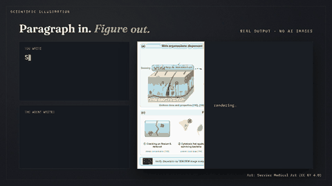
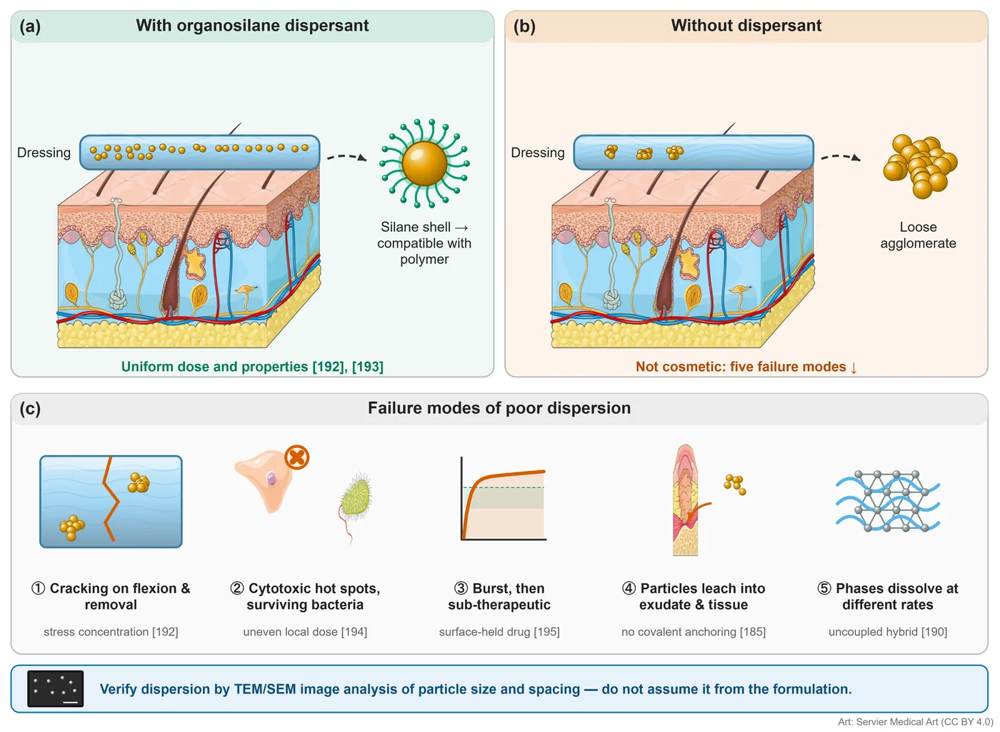
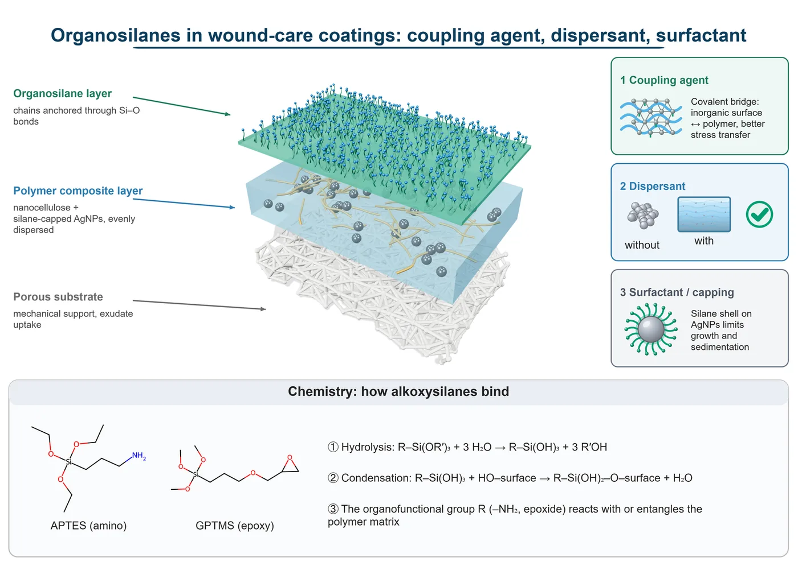
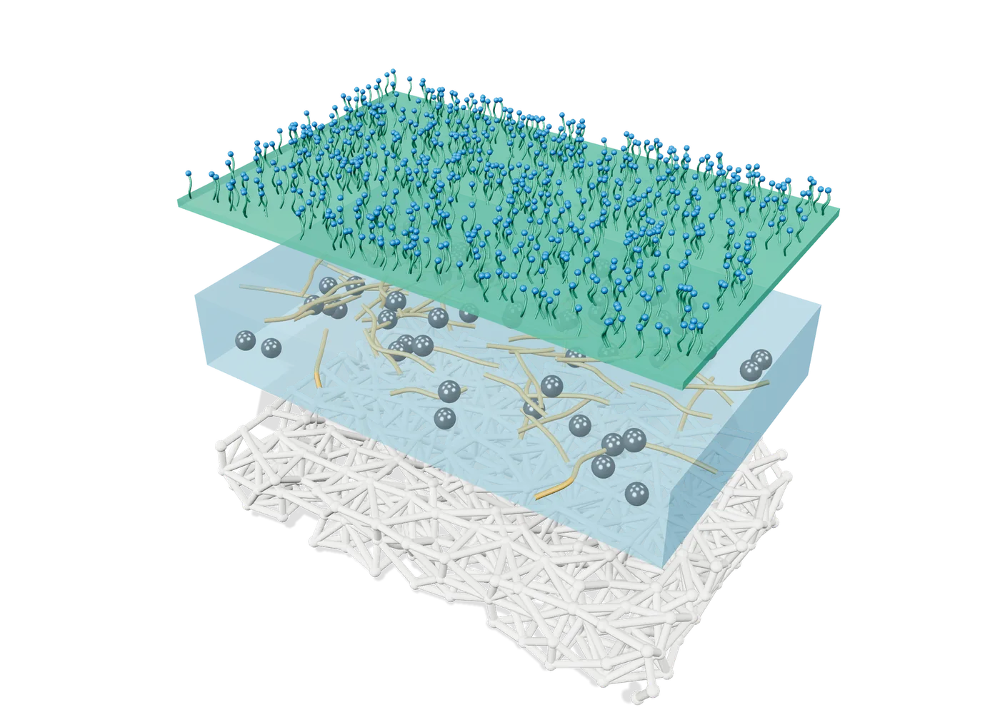
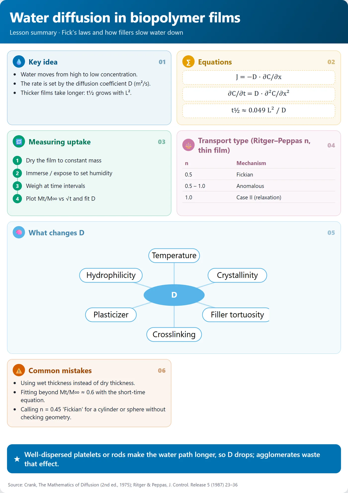
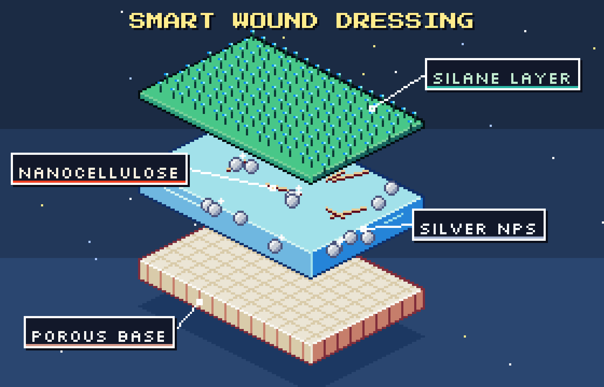
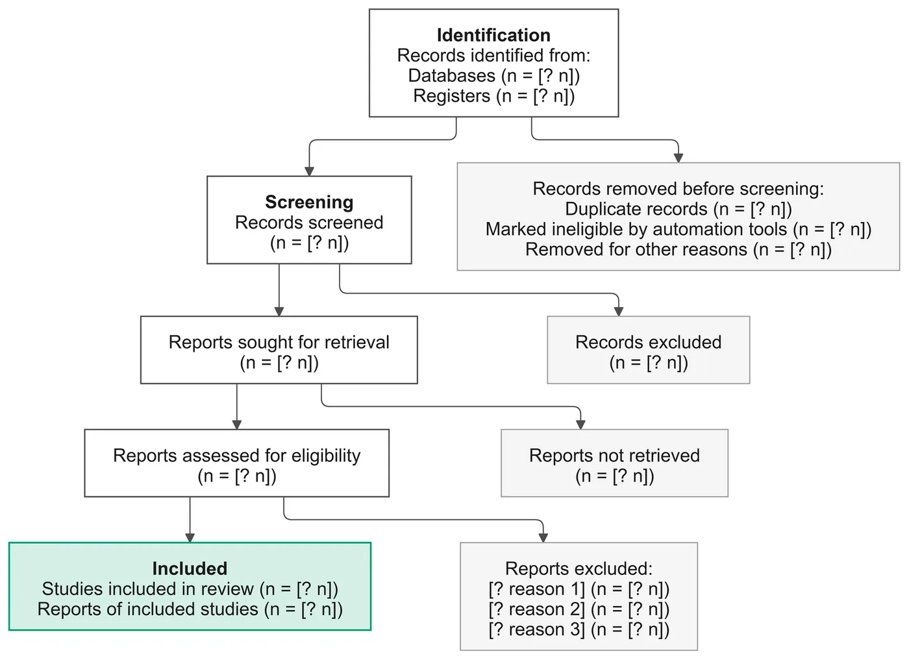

<div align="center">

# Scientific Illustration

**Paragraph in. Figure out.**

An open-source skill for AI coding agents that turns a paragraph of your paper into a publication-ready figure,
3D image, lesson summary or short video — written as editable code, rendered with free medical-grade art.

[](LICENSE)
[](#free-art-libraries-8806-drawings)
[](CHANGELOG.md)
[](https://charaflokman.github.io/scientific-illustration/)



[**Website**](https://charaflokman.github.io/scientific-illustration/) · [**Full video**](docs/promo.mp4) · [Examples](assets/examples) · [Changelog](CHANGELOG.md)

</div>

---

## What you get

| You ask for… | You get | Edit it later? |
|---|---|---|
| A scientific figure / graphical abstract | SVG · PNG · PDF + a browser editor | ✅ drag, recolour, retype |
| A plot of your data (FTIR, XRD, TGA, tensile, release…) | Multi-panel figure, vector text | ✅ |
| A flowchart, PRISMA or mind map from text | SVG · PNG | ✅ |
| A 3D model or 3D image | Interactive 3D page + transparent PNG (up to 4×), or a photoreal Blender Cycles render | ✅ in the page / in the spec |
| A lesson summary | Editable A4 / slide card · PNG · PDF | ✅ type directly in it |
| A process simulation | Interactive HTML with sliders | ✅ |
| A short video | MP4 with an original soundtrack (Remotion) | ✅ change the JSON, re-render |

**Researches first:** give it just a topic ("a figure on ferroptosis") and it pulls recent, highly cited papers from OpenAlex, Europe PMC and Wikipedia (free, no key), then draws only what the sources support and cites them as [n].
**Two levels:** a *simple* version (one message, 3–6 elements, for slides and teaching) or a *detailed* one (multi-panel, values, references, for papers) — or both from the same spec.
**Two styles:** *Academic* (clean, publication-ready) or *Pixel art* (game look, for social media and teaching) — the skill asks which you want.
**You don't need to name the format.** The skill reads what you attach, where it will be used and how you ask, then picks and tells you its choice.

## Input → output

> **You write:** “Show how an organosilane dispersant keeps silver nanoparticles evenly spread in a wound dressing — with vs without, and the failure modes when dispersion is poor.”



The agent wrote [this spec](assets/examples/dispersion_wound_dressing_v2.json); change any word or colour in it and render again.

## Gallery — code-drawn (Route B)

<table>
<tr>
<td width="50%"><br><sub><b>Figure:</b> 3D hero + editable labels + RDKit chemistry</sub></td>
<td width="50%"><br><sub><b>3D image:</b> exploded wound-dressing layers (Three.js)</sub></td>
</tr>
<tr>
<td><br><sub><b>Lesson summary:</b> Fick's laws on one card</sub></td>
<td><br><sub><b>Pixel-art style:</b> drawn natively, not filtered</sub></td>
</tr>
<tr>
<td colspan="2" align="center"><br><sub><b>Diagram from text:</b> PRISMA 2020 flow</sub></td>
</tr>
</table>

## How it works

Every job starts with a choice of two routes:

- **Route A, with AI:** an image AI you choose (you sign in yourself in the agent's browser; Gemini is the tested
  fallback) draws only the scene. The agent adds every label, draws every molecule from SMILES, checks the image for
  errors in crops and writes the AI disclosure. No AI micrographs, spectra or data plots.
- **Route B, without AI:** everything is drawn by code, fully reproducible, no disclosure needed.

Either way the agent first asks a few multiple-choice questions about your project, searches the literature and shows
you the references, and remembers your feedback (`client_profile.md` in your project folder) for the next request.

1. The agent writes a short **JSON spec** (a few thousand tokens) instead of drawing pixels.
2. Python / Node scripts render it. Same spec → same result, every time.
3. The agent looks at the result, fixes overlaps, and hands you the output together with its spec.

## Install

**Requirements:** Windows, macOS or Linux · Python 3.10+ · Node 18+ (for 3D and video) · ~300 MB for video tools, ~1 GB optional for the art libraries.
Optional: [Blender](https://www.blender.org) for photoreal 3D (tested with 5.1; GPU recommended), and Chrome or Edge for export.

```bash
git clone https://github.com/charaflokman/scientific-illustration ~/.claude/skills/scientific-illustration
python ~/.claude/skills/scientific-illustration/scripts/setup_check.py --first-run
```

`setup_check.py` lists what is ready and what is missing, with the install command for each piece; the agent runs it on
first use and asks before installing anything. Python tools for specialised 3D (ASE, OVITO, PyMOL, cellPACK, TPMS
scaffolds) are optional and live in their own virtual environments.

### First test (10 minutes)

1. Open your agent in an empty project folder and ask, in any language:
   *"Make a graphical abstract of chitosan films with ZnO nanoparticles for food packaging."*
2. Answer the route question (A or B) and the short project questions (e.g. `1a 2a 3b 4b …`).
3. Check the references it shows, then open the `.editor.html` file it gives you: double-click any label to retype it,
   drag elements, and save the SVG.
4. Tell it what you like or dislike ("too simple", "the gel looks like glass"): it records the feedback and redraws.
5. Try your own data: *"Plot my FTIR and TGA CSVs as panels (a) and (b) with a T5% table."*

Other agents: clone into `~/.codex/skills/`, `~/.gemini/skills/` or `.agents/skills/`, or point your agent at [`AGENTS.md`](AGENTS.md). Works with Claude Code, Codex CLI, Gemini CLI, Cursor, Copilot, Cline, OpenCode and others, with any model.

Then ask in plain words, in any language:

> *"Make a graphical abstract from this methods section"* · *"Plot my FTIR and TGA CSVs as panels (a) and (b)"* · *"Summarise this lesson as one card"* — in any language

## Free art libraries (about 23,000 drawings)

`python scripts/library.py fetch` downloads them once (`--only reactome phylopic` for a subset); `library.py search fibroblast` searches all of them. Credits are added to the figure automatically.

| Library | Licence | Drawings |
|---|---|---:|
| [Servier Medical Art](https://smart.servier.com) — searched first, drawn by medical illustrators | CC BY 4.0 | 1,801 |
| [DBCLS TogoTV](https://togotv.dbcls.jp) | CC BY 4.0 | 2,069 |
| [Bioicons](https://bioicons.com) | per icon | 2,830 |
| [Health Icons](https://healthicons.org) | CC0 | 2,106 |
| [Reactome Icon Library](https://reactome.org/icon-lib) — proteins, receptors, transporters, drugs, cell types | CC BY 4.0 | 2,571 |
| [SciDraw](https://scidraw.io) — neuroscience, lab animals, behaviour setups (each with a DOI) | CC BY 4.0 / CC0 | 614 |
| [PhyloPic](https://www.phylopic.org) — organism silhouettes across the tree of life (non-commercial and share-alike images are skipped) | CC0 / CC BY | 11,207 |

## Limitations

- Schematics, 3D renders and (Route A) disclosed AI scenes only — never micrographs, spectra or invented data.
- Some journals refuse AI-generated images: use Route B for those, and check the journal's policy.
- Library art is high-resolution PNG; labels and shapes stay vector.
- You still check the science: a wrong prompt gives a wrong figure.
- Smaller models may need a second pass on layout.
- Video rendering takes a few minutes and needs Node; photoreal renders take 1–5 minutes on a GPU.

## Privacy and safety

- Rendering runs on your computer; nothing about your work is uploaded by the skill. What your agent sends to its own provider follows that agent's settings.
- Downloaded SVGs are cleaned of scripts, event handlers and external links.
- npm packages are pinned and installed with install scripts turned off.
- No API keys, cookies or logins are stored. In Route A you sign in to the image AI yourself; the agent never types a password.

## Licence and citation

- **Code:** [MIT](LICENSE). Figures you make are yours.
- **Library art:** CC BY 4.0 (Servier, TogoTV, Reactome, most SciDraw), CC0 / CC BY (PhyloPic, Bioicons) or CC0 (Health Icons) — keep the credit line the skill adds.
- **Video:** rendered with [Remotion](https://remotion.dev), free for individuals and teams of up to 3; larger companies need a [Remotion licence](https://remotion.dev/license).

If it helped your paper, please cite it — see [`CITATION.cff`](CITATION.cff) (GitHub shows a “Cite this repository” button).
