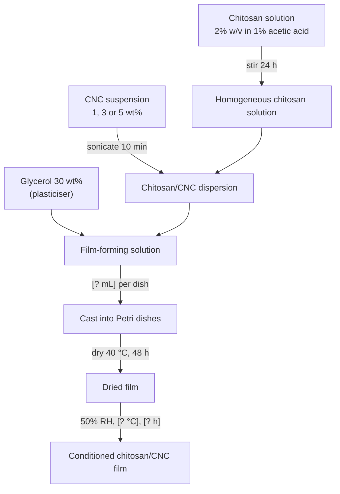
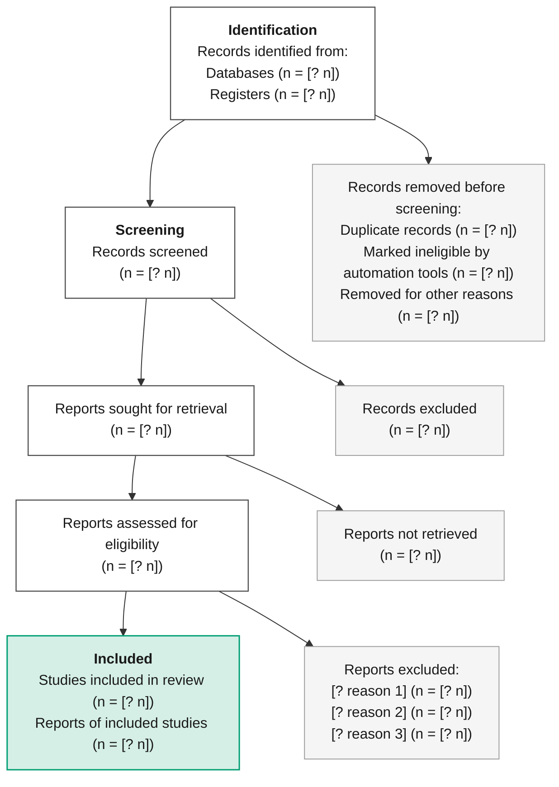

# Diagram mode: text to editable diagram

The open alternative to Napkin AI. Read the user's text, write **Mermaid or D2 source**,
render it **locally** with `scripts/render_diagram.py`, and hand back the source plus SVG/PNG.
The user edits the text source (or the SVG) afterwards.

**Privacy rule:** render only with local tools (mmdc, d2, dot). Never paste user content into
Kroki, mermaid.ink, mermaid.live, the D2 playground or any other online renderer.

## 1. Render command

```bash
python scripts/render_diagram.py flow.mmd                       # -> flow.svg next to the source
python scripts/render_diagram.py flow.d2 -o out/flow.svg --png 600 --pdf
python scripts/render_diagram.py flow.mmd --width-mm 174 --check  # journal width + layout check
python scripts/render_diagram.py --classdefs                      # print theme classes to paste
```

- Inputs: `.mmd`/`.mermaid` (Mermaid), `.d2` (D2), `.dot`/`.gv` (Graphviz).
- Tools are looked up via flags, then env vars, then PATH: `--mmdc`/`RV_MMDC` (fallback
  `npx -y @mermaid-js/mermaid-cli`), `--d2`/`RV_D2`, `--dot`/`RV_DOT`, `--browser`/`RV_BROWSER`.
  A puppeteer config pointing to the installed Chrome/Edge is written automatically, so
  puppeteer's own Chromium download is not needed.
- PNG/PDF go through `scripts/export.py` (needs playwright; `RV_PYTHON` selects the interpreter).
- `--theme research` (default) | `plain` (tool colours, still editable text) | `none`.
- D2: `--layout dagre` (default, labels sit cleanly mid-edge) or `--layout elk` (orthogonal
  elbows, more compact; labels can touch bends). `--pad 24` px.
- Output line reports size, number of `<text>` elements, `foreignObject` count (must be 0)
  and any `[? ...]` placeholders still in the figure.
- On a syntax error it prints the tool's message, the line number in *your* file and the
  source lines around it, exit code 1. Fix the source and re-run. Exit 3 = tool missing.
- Graphviz is optional. If `dot` is missing: `winget install Graphviz.Graphviz` (Windows),
  `brew install graphviz`, `sudo apt install graphviz`.

## 2. Choosing the tool

| Need | Use | Why |
|---|---|---|
| Flowchart, process, PRISMA, study design, decision tree | **Mermaid** `flowchart` | Users know it, renders in GitHub/Obsidian/Notion, edits easily |
| Sequence of interactions (sample - instrument - software) | Mermaid `sequenceDiagram` | Only good option |
| Timeline, Gantt (project plan, thesis schedule) | Mermaid `timeline` / `gantt` | Built in |
| Mindmap, topic overview | Mermaid `mindmap` | Built in, radial |
| Fabrication process with conditions on arrows, nested groups (e.g. "Solution prep" box containing steps) | **D2** | Cleaner containers, labels on edges read well, classes |
| Concept map, many cross-links | D2 (dagre) or Graphviz | Mermaid gets tangled above ~15 cross-links |
| Causal loop diagram (biology feedback, physics coupling) with +/- polarities | **Graphviz** `neato`/`dot`, else D2 | Cycles lay out better; `rank=same` control |
| Large graph (>40 nodes) or exact rank control | Graphviz | Mature layout |

Default to Mermaid unless one of the D2/Graphviz reasons applies. If both work, ask
nothing; pick Mermaid and say the D2 version is available.

## 3. The Napkin pattern: text -> structure -> template

1. **Extract entities**: materials, samples, steps, groups, outcomes, variables. Keep the
   user's wording and units exactly.
2. **Extract relations**: sequence (then/after), inputs (add X to Y), conditions (at 40 °C
   for 48 h), branching (if/otherwise), causality (increases/decreases), counts (n = ).
3. **Pick the diagram type** from the relation mix:
   sequence + conditions -> process flowchart; counts + exclusions -> PRISMA/CONSORT flow;
   groups x treatments -> study design; causes with feedback -> causal loop; hierarchy ->
   mindmap; dates -> timeline/Gantt.
4. **When the text is ambiguous, offer 2-3 structures**, e.g. for a film-casting paragraph:
   (a) linear flowchart with conditions on arrows, (b) swimlanes per component
   (chitosan / CNC / glycerol) merging into casting, (c) timeline by day. Render the
   first, describe the others in one line each.
5. **Never invent values.** Anything missing becomes a placeholder: `[? °C]`, `[? h]`,
   `[? mL]`, `[? n]`, `[? reason 1]`. The renderer lists them; tell the user which remain.
6. Node = thing/state (noun), edge label = action + condition (verb, value, unit).

## 4. Theme ("research")

Arial/Helvetica, near-black text `#1A1A1A`, grey lines `#4D4D4D`, neutral fills `#F5F5F5`,
Okabe-Ito accents (colour-blind safe) used as stroke + light tint fill so text stays dark:
blue `#0072B2`, orange `#E69F00`, green `#009E73`, vermillion `#D55E00`, purple `#CC79A7`,
sky `#56B4E9`. Never encode meaning by colour alone: class names map to roles.

Mermaid classes (paste at the end of the diagram; `python scripts/render_diagram.py --classdefs`):

```
classDef material fill:#DCEBF7,stroke:#0072B2,stroke-width:1.5px,color:#1A1A1A
classDef step fill:#F5F5F5,stroke:#4D4D4D,stroke-width:1px,color:#1A1A1A
classDef condition fill:#FBEBD0,stroke:#E69F00,stroke-width:1.5px,color:#1A1A1A
classDef output fill:#D5EFE6,stroke:#009E73,stroke-width:1.5px,color:#1A1A1A
classDef excluded fill:#F8DFD2,stroke:#D55E00,stroke-width:1px,color:#1A1A1A
classDef missing fill:#FFFFFF,stroke:#D55E00,stroke-width:1.5px,stroke-dasharray:5 3,color:#D55E00
```
Use: `A["Chitosan"]:::material` or `class A,B step`.

D2 classes (theme colours are injected by the renderer; these add roles):

```d2
classes: {
  material: {style: {fill: "#DCEBF7"; stroke: "#0072B2"; stroke-width: 2; font-color: "#1A1A1A"}}
  step: {style: {fill: "#F5F5F5"; stroke: "#4D4D4D"; font-color: "#1A1A1A"}}
  output: {style: {fill: "#D5EFE6"; stroke: "#009E73"; stroke-width: 2; font-color: "#1A1A1A"}}
  missing: {style: {fill: "#FFFFFF"; stroke: "#D55E00"; stroke-dash: 4; font-color: "#D55E00"}}
}
x: "Chitosan" {class: material}
```

## 5. Template: biopolymer film fabrication (Mermaid)

Values shown are from a real request; replace with the user's, keep `[? ]` for gaps.



## 6. Template: the same process in D2

```d2
direction: down
# + classes block from section 4
chitosan: "Chitosan solution\n2% w/v in 1% acetic acid" {class: material}
cnc: "CNC suspension\n1, 3 or 5 wt%" {class: material}
glycerol: "Glycerol 30 wt%\n(plasticiser)" {class: material}
solution: "Homogeneous chitosan solution" {class: step}
dispersion: "Chitosan/CNC dispersion" {class: step}
ffs: "Film-forming solution" {class: step}
cast: "Cast into Petri dishes" {class: step}
dried: "Dried film" {class: step}
film: "Conditioned chitosan/CNC film" {class: output}
chitosan -> solution: "stir 24 h"
solution -> dispersion
cnc -> dispersion: "sonicate 10 min"
dispersion -> ffs
glycerol -> ffs
ffs -> cast: "[? mL] per dish"
cast -> dried: "dry 40 °C, 48 h"
dried -> film: "50% RH, [? °C], [? h]"
```
D2 edge labels render italic grey, which separates conditions from materials. To group
steps, nest them: `prep: "Solution preparation" { chitosan; solution }` and connect
`prep.solution -> dispersion`.

## 7. Template: PRISMA 2020 flow (Mermaid)

Counts are **never** estimated: every number stays `[? n]` until the user gives it.
For reviews that also searched websites/citations, add a third column of the same shape.


Layout notes: declare the main column first; the invisible `~~~` chain keeps exclusion
boxes in one straight right-hand column. Mermaid places each exclusion box one row below
its parent (not level with it). If the journal wants the official geometry (side boxes
level with the main box, phase bands on the left), finish in the figure editor/Inkscape
or use Graphviz with `{rank=same; sc1; sc2}`. Check arithmetic before finishing:
screened = identified - removed; assessed = sought - not retrieved; included = assessed - excluded.

## 8. Other structures (short recipes)

- **Study design**: `flowchart LR`; population -> randomisation/allocation -> groups
  (one node per arm, `class ... material`) -> intervention edge labels with dose/time ->
  outcomes (`output`). Sample sizes as `[? n]`.
- **Causal loop** (Graphviz): `digraph { layout=dot; a -> b [label="+"]; b -> a [label="-"] }`;
  mark loops with a centre label `R`/`B` (reinforcing/balancing). In D2: `a -> b: "+"`.
- **Concept map**: D2, nouns as nodes, linking phrases as edge labels ("is crosslinked by").
- **Sequence**: `sequenceDiagram` with `participant` per instrument/actor; `Note over`.
- **Gantt**: `gantt` + `dateFormat YYYY-MM-DD`; never invent dates, use `[? date]` in a note.

## 9. How the user edits

1. **Edit the text** (`.mmd` / `.d2`) and re-run the render command. Best for changing
   wording, values, adding steps. Also works in VS Code, Obsidian, GitHub (Mermaid).
2. **Edit the SVG** in the skill's figure editor (`scripts/editor.html`) or Inkscape: labels
   are real `<text>` (Mermaid is rendered with `htmlLabels: false`; D2 font subsets are
   stripped and replaced by Arial) so text can be retyped, recoloured, moved.
   Text edits made in the SVG are lost if the source is re-rendered: say this.
3. **PowerPoint (Microsoft 365)**: Insert > Pictures > the `.svg`, then right-click >
   *Convert to Shape*; text becomes editable text boxes. Older Office: use the PNG.
4. Final export: `--png 600` (line art) / `--pdf` (vector) at `--width-mm 85` (1 column) or
   `174` (2 columns); run `--check` to catch text below 5 pt and leftover placeholders.

## 10. Pitfalls (tested with mermaid-cli 12 / d2 0.9)

- **Mermaid special characters**: quote every label that contains `( ) [ ] { } : ; , % # |`
  or `°`: `A["Dry (40 °C, 48 h)"]`, edge labels `-->|"stir 24 h"|`. Unquoted parentheses
  give `Parse error ... got 'PS'`. `end` (lowercase) as a node id breaks flowcharts.
- **Line breaks with htmlLabels false**: `<br/>` works; `\n` inside a normal quoted label
  also works; inside markdown strings (backticks) use a real newline.
- **Bold/italic**: `<b>`/`<i>` are shown literally with htmlLabels false. Use markdown
  strings: ``A["`**Screening**
  Records screened`"]``.
- **Sub/superscripts**: `<sub>`/`<sup>` are shown literally. Use Unicode: H₂O, CO₂, Ca²⁺,
  10⁻³, m², µm, °C, α, β, Δ, ±, ×. These render in Arial and stay editable.
- Mermaid text wraps at `wrappingWidth` 480 px; break long lines yourself with `<br/>` so a
  placeholder like `[? n]` is never split.
- Mermaid flowchart layout is automatic: control it by declaration order, `~~~` invisible
  links, `direction` (`TD`/`LR`) and subgraphs. Subgraph `direction` is ignored when its
  nodes link outside the subgraph.
- D2: labels with `#`, `:` , `;`, `{` must be quoted; newline is `\n` inside double quotes.
  The renderer adds one hidden line of theme config at the top; error line numbers are
  already corrected to match your file. A file's own `vars: {d2-config: ...}` still wins.
- D2 grid layouts (`grid-columns`) fill cells in an order that is hard to control and draw
  connections as straight diagonals; avoid them for flow diagrams.
- Labels in `[? ...]` are meant to stand out; the final figure must not contain any.
